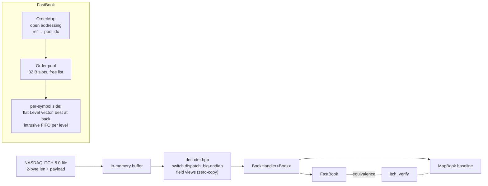

# itch-engine: NASDAQ TotalView-ITCH 5.0 feed handler & L3 order book (C++20)

A zero-copy decoder for every ITCH 5.0 message type, plus a full-depth (order-by-order) book for every symbol. It is checked level-for-level against a naive `std::map` book and benchmarked on **real NASDAQ data**.

**Measured** on a shared 8-vCPU KVM cloud VM, single pinned core, using the first 33,063,085 messages of NASDAQ's 30 Jan 2019 sample (8,694 symbols), median of 5 runs. Full method in [bench/RESULTS.md](bench/RESULTS.md).

| per message, decode + book update | fast book | `std::map` book |
|---|---|---|
| p50 | 151 ns | 247 ns |
| p99 | 805 ns | 1,781 ns |
| p99.9 | 2,389 ns | 4,051 ns |
| throughput | 7,242,047 msgs/s | 2,865,950 msgs/s (**2.53×** slower) |

These are in-process numbers replayed from memory, not wire-to-wire or tick-to-trade.

## Research: order-book imbalance study
Full-day replay (368M messages, 30 Jan 2019) of the 50 most active symbols through `FastBook`. A logistic model on level-1 queue imbalance, fitted on the morning only, predicts the direction of the next mid-price move with **63.5% out-of-sample accuracy** on the afternoon (AUC 0.690, 15.3M test events). That compares with 53.3% for a last-move rule and 50.4% for the majority class. Method, confidence intervals and caveats are in [bench/IMBALANCE_STUDY.md](bench/IMBALANCE_STUDY.md).

## Architecture


## Layout
```
include/itch/messages.hpp   all 23 ITCH 5.0 message types: lengths + field accessors
include/itch/decoder.hpp    dispatch() and decode_buffer() (templated on the handler)
include/book/fast_book.hpp  cache-friendly L3 book
include/book/order_map.hpp  open-addressing hash map (backward-shift deletion)
include/book/map_book.hpp   std::map + std::list + unordered_map baseline
include/book/book_handler.hpp  ITCH → book operations (A/F/E/C/X/D/U)
src/replay.cpp              itch_replay: stats / throughput / latency (rdtsc histogram)
src/verify.cpp              itch_verify: fast vs baseline full-depth comparison
src/features_main.cpp       itch_features: top-of-book event stream for the imbalance study
scripts/imbalance_study.py  imbalance / OFI analysis (run_imbalance_study.sh reproduces it)
tests/                      Catch2 unit + randomised equivalence tests
bench/                      run_all.sh, summarize.py, results.json, RESULTS.md, raw results
scripts/get_data.sh         downloads a slice of a real NASDAQ sample day
scripts/extract_sample.py   exports an AAPL message sequence (used by the portfolio site)
```

## Build, test, run
```bash
cmake -S . -B build -DCMAKE_BUILD_TYPE=Release && cmake --build build -j
./build/tests                                   # Catch2
cmake -S . -B build-asan -DCMAKE_BUILD_TYPE=Debug -DITCH_SANITIZE=ON && cmake --build build-asan -j && ./build-asan/tests
./scripts/get_data.sh                           # ~400 MiB gzip slice -> data/01302019.itch (not committed)
./build/itch_replay data/01302019.itch --mode stats
./build/itch_verify data/01302019.itch          # 0 mismatches expected
RUNS=5 CPU=2 bench/run_all.sh data/01302019.itch
```

## Design trade-offs
- **Zero-copy views instead of packed structs.** Accessors `memcpy` + `bswap` from the buffer, which avoids unaligned-access UB and `#pragma pack`, and compiles to `movbe`-style loads.
- **Price levels as a sorted flat vector with the best level at the back.** Most ITCH traffic touches the top few levels, so a backwards scan of up to 8 entries usually finds the level, and inserting or erasing near the top moves very few elements. Deep levels fall back to binary search. The cost: an insert deep in the book is O(levels) memmove. A price-indexed ladder (array over ticks) would make that O(1) but costs memory per symbol and needs re-centring.
- **Order pool + open-addressing map.** There's no allocation per order. Pool indices are 32-bit, so a slot is 32 bytes. The map is sized once (2^23 slots). Backward-shift deletion avoids tombstone build-up from the very high delete rate (D ≈ 38% of messages).
- **Replace (U) = delete + add**, which loses queue priority as the spec requires. Executions reduce shares, and the order is removed at zero.
- **Allocations:** pool, map and level reservations happen up front or on Stock Directory messages. Measured hot-path allocations after warm-up: 84 in 33M messages (from symbols with >512 price levels). Not strictly zero.
- **Measurement:** rdtsc around each message includes about 46 cycles of fencing, which is subtracted. Timing every message adds some observer effect, so throughput is measured separately without timing.

## Not implemented (yet)
- Network path: MoldUDP64/UDP replay, PCAP generation, AF_XDP or DPDK receive. None of these exist in this repo, so nothing here claims kernel bypass.
- Matching engine, TCP exchange simulator and toy strategy (end-to-end tick-to-trade).
- Full-day latency benchmark (only the first 33M messages are benchmarked; the imbalance study replays the full day), perf/flame-graph profiling, and CI workflow.

Data: NASDAQ TotalView-ITCH 5.0 sample files, https://emi.nasdaq.com/ITCH/Nasdaq%20ITCH/. Data files are not committed.
