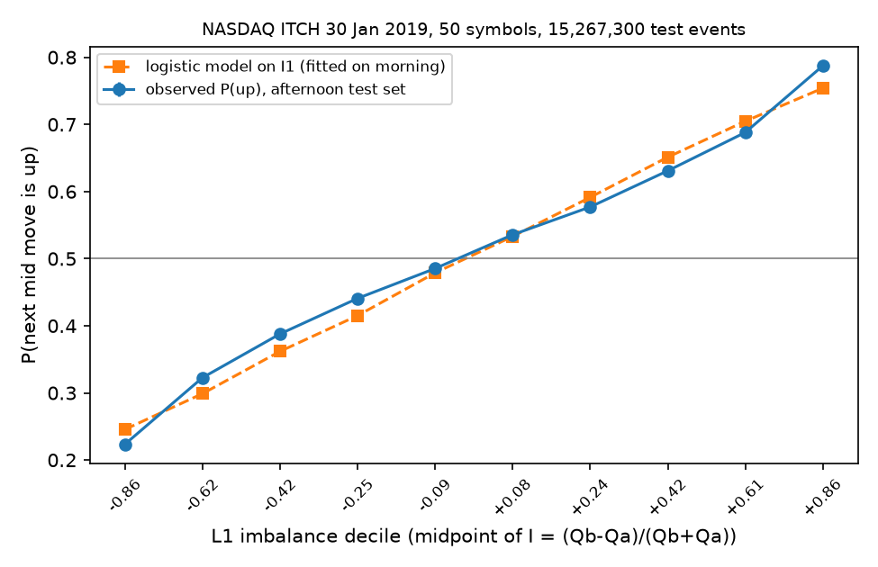
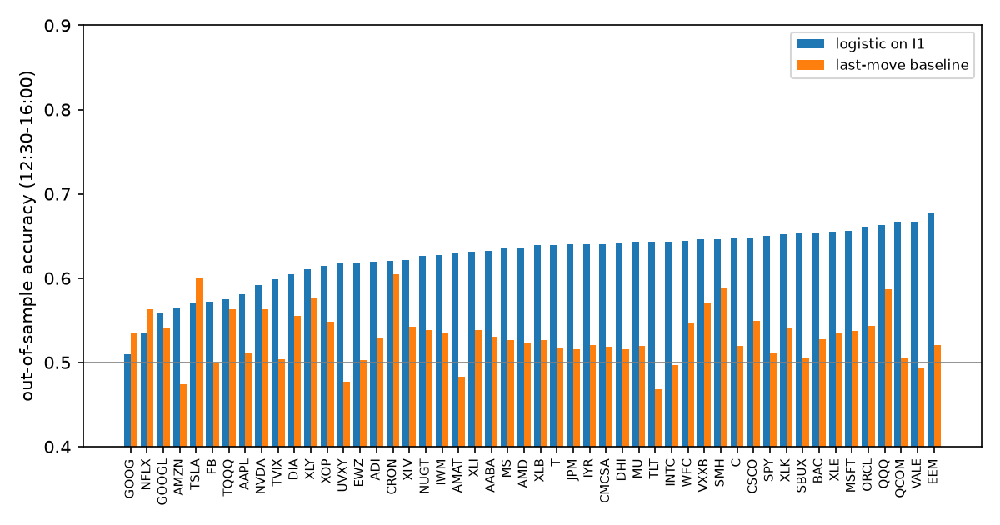

# Order-book imbalance → next mid-price move (out of sample)

Does the size imbalance at the best bid and ask predict the direction of the next mid-price move? Measured on a full day of real NASDAQ TotalView-ITCH 5.0 data, replayed through this repo's `FastBook`, with a morning/afternoon chronological split. All numbers below are produced by `scripts/run_imbalance_study.sh`; the raw outputs are in [`bench/imbalance/`](imbalance/).

## Headline (test set: 12:30–16:00 ET, models fitted on 09:30–12:30 ET only)

| | out-of-sample accuracy | 95% CI | AUC |
|---|---|---|---|
| Majority class (from training) | 50.4% | [50.0, 50.8] | – |
| Last-move rule (repeat or reverse the previous mid move, chosen on training) | 53.3% | [53.0, 53.7] | – |
| **Logistic regression on L1 imbalance I** | **63.5%** | [63.2, 63.8] | **0.690** [0.685, 0.694] |
| Logistic on I + depth imbalance (levels 2–5) + OFI (last 10 events) + last move | 64.0% | [63.7, 64.3] | 0.695 [0.690, 0.698] |

- **Data:** NASDAQ TotalView-ITCH 5.0 sample file for **30 January 2019** (`01302019.NASDAQ_ITCH50.gz`, 4,764,426,091 bytes gzip, 11,245,883,092 bytes raw, **368,366,634 messages**), from https://emi.nasdaq.com/ITCH/Nasdaq%20ITCH/. The whole day is replayed (the earlier latency benchmark used only the first 33M messages).
- **Symbols:** the **50** symbols with the most book messages (A/F/E/C/X/D/U) during regular hours, chosen before looking at any result (list in `per_symbol.csv`; includes QQQ, SPY, IWM, AMD, AAPL, MSFT, NVDA, AMZN, TSLA, FB, GOOG/GOOGL).
- **Events:** 28,043,504 top-of-book changes in regular hours after collapsing same-nanosecond updates; **12,772,556 training events** and **15,267,300 test events** with a defined next move.
- Gain of the I-only model over the last-move rule: **10.2 percentage points** (95% CI [9.7, 10.6]); over the majority class: 13.1 pp ([12.6, 13.7]).
- Per symbol, the I-only model beats the last-move rule on **47 of 50** symbols and the majority class on 49 of 50. Accuracy ranges from 51.0% to 67.8% (median 63.8%). The fitted coefficient on I is positive for all 50 symbols.
- **Robustness (one prediction per move):** sampling the afternoon only at the first event after each mid change (so each target is used once), the I-only model scores **58.9%** vs 54.0% for the last-move rule, AUC 0.629, on 1,382,298 mid moves.

## Calibration: L1 imbalance decile vs P(next move up), test set

| decile | I range | test events | observed P(up) | model P(up) |
|---|---|---|---|---|
| 1 | -1.00 to -0.72 | 1,526,948 | 0.223 ± 0.001 | 0.246 |
| 2 | -0.72 to -0.51 | 1,526,550 | 0.323 ± 0.001 | 0.299 |
| 3 | -0.51 to -0.33 | 1,753,642 | 0.388 ± 0.001 | 0.362 |
| 4 | -0.33 to -0.18 | 1,303,522 | 0.441 ± 0.001 | 0.415 |
| 5 | -0.18 to +0.00 | 1,863,831 | 0.485 ± 0.001 | 0.479 |
| 6 | +0.00 to +0.15 | 1,185,894 | 0.536 ± 0.001 | 0.533 |
| 7 | +0.15 to +0.33 | 1,749,644 | 0.577 ± 0.001 | 0.591 |
| 8 | +0.33 to +0.50 | 1,355,859 | 0.631 ± 0.001 | 0.651 |
| 9 | +0.50 to +0.71 | 1,474,683 | 0.688 ± 0.001 | 0.705 |
| 10 | +0.71 to +1.00 | 1,526,727 | 0.787 ± 0.001 | 0.754 |

The relationship is monotonic: from 22.3% up-moves in the most ask-heavy decile to 78.7% in the most bid-heavy one, and the model fitted on the morning stays well calibrated in the afternoon.

By spread at the time of the prediction: when the spread is 1 tick, accuracy is 63.8% on 11,042,216 events; at 2+ ticks it is 62.9% on 4,225,084 events. The weakest names (GOOG, NFLX, GOOGL, AMZN, TSLA) are high-priced stocks with median spreads of 14–64 ticks, so queue sizes at the touch say less about where the mid goes next.

## Order-flow imbalance regression (Cont, Kukanov & Stoikov 2014)

Per symbol, 10-second buckets, mid change in ticks regressed on the summed event OFI; fitted on the morning, R² measured on the afternoon against the morning-mean forecast.

| | median out-of-sample R² across 50 symbols | mean | symbols with R² > 0 |
|---|---|---|---|
| Contemporaneous (OFI in the same 10 s explains that bucket's mid change) | 0.431 | 0.297 | 44 |
| Predictive (previous bucket's OFI → next bucket's mid change) | -0.0003 | -0.0029 | 19 |

OFI explains a large share of same-interval price changes, as in the paper, but has essentially no forecasting power for the next 10 seconds. The predictable part found above lives at the scale of the next single price change.

## Per-symbol results

| symbol | test events | median spread (ticks) | majority | last move | logistic on I | AUC (I) | OFI R² (contemp.) |
|---|---|---|---|---|---|---|---|
| QQQ | 1,117,194 | 1 | 51.0% | 58.7% | 66.3% | 0.726 | 0.44 |
| SPY | 802,445 | 1 | 50.0% | 51.1% | 65.0% | 0.707 | 0.39 |
| MSFT | 549,380 | 1 | 50.9% | 53.7% | 65.6% | 0.714 | 0.38 |
| IWM | 535,419 | 1 | 50.8% | 53.6% | 62.7% | 0.676 | 0.48 |
| SMH | 483,607 | 1 | 49.6% | 58.9% | 64.6% | 0.706 | 0.45 |
| EWZ | 457,081 | 1 | 49.6% | 50.3% | 61.8% | 0.673 | 0.55 |
| XLK | 434,659 | 1 | 51.3% | 54.2% | 65.2% | 0.715 | 0.43 |
| VXXB | 432,772 | 1 | 51.1% | 57.1% | 64.6% | 0.704 | 0.56 |
| XLI | 419,888 | 1 | 48.3% | 53.8% | 63.1% | 0.685 | 0.09 |
| AMD | 416,864 | 1 | 48.6% | 52.2% | 63.6% | 0.706 | 0.11 |
| INTC | 372,366 | 1 | 51.0% | 49.7% | 64.4% | 0.706 | 0.66 |
| EEM | 359,377 | 1 | 48.9% | 52.1% | 67.8% | 0.753 | 0.47 |
| XLV | 333,527 | 1 | 49.8% | 54.2% | 62.2% | 0.674 | 0.43 |
| MU | 317,635 | 1 | 49.1% | 52.0% | 64.3% | 0.698 | 0.43 |
| BAC | 317,092 | 1 | 52.1% | 52.8% | 65.4% | 0.721 | 0.50 |
| WFC | 310,534 | 1 | 49.4% | 54.6% | 64.4% | 0.708 | 0.64 |
| TLT | 309,696 | 1 | 49.5% | 46.9% | 64.4% | 0.700 | 0.50 |
| AMAT | 306,855 | 1 | 51.3% | 48.3% | 63.0% | 0.687 | -1.06 |
| DIA | 298,154 | 3 | 49.3% | 55.5% | 60.4% | 0.646 | 0.52 |
| IYR | 297,311 | 1 | 48.0% | 52.1% | 64.0% | 0.697 | 0.20 |
| XLY | 295,933 | 1 | 49.7% | 57.6% | 61.1% | 0.660 | -0.00 |
| UVXY | 294,598 | 3 | 50.4% | 47.8% | 61.8% | 0.661 | 0.39 |
| JPM | 293,735 | 1 | 50.6% | 51.6% | 64.0% | 0.693 | 0.53 |
| AAPL | 293,084 | 2 | 49.4% | 51.1% | 58.1% | 0.610 | 0.67 |
| CMCSA | 287,505 | 1 | 52.5% | 51.8% | 64.1% | 0.697 | 0.35 |
| CSCO | 281,234 | 1 | 48.6% | 54.9% | 64.9% | 0.706 | 0.63 |
| ORCL | 281,098 | 1 | 55.8% | 54.3% | 66.1% | 0.718 | -2.54 |
| C | 271,247 | 1 | 50.0% | 51.9% | 64.8% | 0.703 | 0.52 |
| NUGT | 270,471 | 1 | 50.5% | 53.8% | 62.7% | 0.673 | 0.73 |
| XOP | 267,201 | 1 | 51.5% | 54.8% | 61.4% | 0.671 | 0.27 |
| XLE | 267,030 | 1 | 50.1% | 53.4% | 65.5% | 0.713 | 0.16 |
| MS | 259,851 | 1 | 48.9% | 52.6% | 63.5% | 0.690 | 0.50 |
| FB | 258,626 | 3 | 50.8% | 49.9% | 57.2% | 0.604 | 0.45 |
| XLB | 252,206 | 1 | 49.2% | 52.6% | 63.9% | 0.698 | 0.41 |
| CRON | 241,625 | 1 | 51.5% | 60.4% | 62.0% | 0.662 | 0.62 |
| TQQQ | 233,805 | 1 | 50.4% | 56.3% | 57.5% | 0.605 | 0.61 |
| QCOM | 231,823 | 1 | 51.3% | 50.5% | 66.7% | 0.732 | 0.17 |
| DHI | 217,286 | 1 | 50.7% | 51.5% | 64.2% | 0.698 | 0.01 |
| SBUX | 217,048 | 1 | 53.6% | 50.6% | 65.3% | 0.703 | -0.03 |
| TVIX | 210,404 | 2 | 50.4% | 50.4% | 59.9% | 0.630 | 0.40 |
| VALE | 192,535 | 1 | 53.1% | 49.3% | 66.7% | 0.745 | 0.79 |
| NVDA | 191,322 | 4 | 51.1% | 56.3% | 59.1% | 0.620 | 0.30 |
| T | 179,342 | 1 | 48.1% | 51.7% | 64.0% | 0.720 | -0.41 |
| AABA | 161,967 | 2 | 52.3% | 53.1% | 63.3% | 0.677 | 0.62 |
| ADI | 98,864 | 2 | 51.2% | 53.0% | 61.9% | 0.663 | 0.45 |
| NFLX | 81,654 | 15 | 49.0% | 56.3% | 53.4% | 0.573 | -0.39 |
| TSLA | 78,801 | 14 | 51.3% | 60.1% | 57.1% | 0.586 | 0.32 |
| AMZN | 72,160 | 50 | 53.9% | 47.4% | 56.4% | 0.577 | 0.53 |
| GOOGL | 59,706 | 64 | 45.5% | 54.1% | 55.8% | 0.582 | 0.30 |
| GOOG | 53,283 | 64 | 51.0% | 53.6% | 51.0% | 0.540 | 0.32 |

## Method

1. `itch_features` (src/features_main.cpp) memory-maps the raw file and replays every message through `BookHandler<FastBook>`, so books are built from the start of the day, pre-market included. Pass 1 (`--count`) counts book messages per symbol during regular hours; the top 50 are tracked. Pass 2 writes a 64-byte record each time a tracked symbol's best bid or ask price or size changes between 09:30:00 and 16:00:00 ET: timestamp, best bid/ask price, and sizes at the top 5 levels per side. A full-day pass takes about 1.5 minutes on the 8-vCPU VM.
2. `scripts/imbalance_study.py`: events sharing a nanosecond timestamp are collapsed to the last state; crossed, locked or one-sided books are dropped (none occurred in any of the 28,676,880 raw records). Target = sign of the next non-zero mid change in event time. Features: I = (Qb − Qa)/(Qb + Qa) at level 1; cumulative-depth imbalance over levels 1–k for k = 2..5; Cont–Kukanov–Stoikov OFI summed over the last 10 events and divided by current L1 depth; sign of the previous mid move.
3. Split: train 09:30–12:30, test 12:30–16:00. Training events whose next move falls after 12:30 are dropped, so no test-period price enters training. One model per symbol (scikit-learn `LogisticRegression`, default L2, C = 1). Baselines use only training information.
4. Uncertainty: moving-block bootstrap with 1-minute blocks of the afternoon, all symbols resampled together to keep cross-symbol correlation (1,000 resamples for accuracy, 100 for AUC, seed 20190130). 95% percentile intervals.
5. Reproduce: `scripts/run_imbalance_study.sh` (requires `scripts/requirements.txt`).

## Caveats

- **One day of data** from one venue. NASDAQ's own book only: no other exchanges, so this is not the consolidated NBBO, and hidden or midpoint liquidity is not seen.
- **Predictability, not profitability.** Predicting the direction of the next mid move does not mean a trade makes money. The mid usually moves by half a tick or one tick, which is less than the spread a taker pays, and there are no fees, latency, queue position or market impact here.
- Test events are not independent. Consecutive book updates before the same mid move share one target, which is why the CIs use a block bootstrap and why the one-prediction-per-move check is reported. On that stricter count, accuracy is 58.9%.
- Event time, not clock time. The target is the next move whenever it happens, with no fixed horizon.
- Symbol selection uses regular-hours message counts for the whole day, including the afternoon. This is a liquidity filter, not a result filter.
- Accuracy falls as the typical spread widens (Spearman rank correlation −0.71 between per-symbol accuracy and median spread across the 50 symbols). For the high-priced names with median spreads of 14–64 ticks (GOOG, GOOGL, AMZN, NFLX, TSLA), the effect is small.
